# Scanning chips with the autoscanner

How to scan exfoliated chips on the BX51 with the FlakeIdentifier scan program: the program finds each chip's edges,
scans it at 10x, finds the flakes while it scans, and takes 100x images of the best ones. Results open in a chip
viewer and in the vdW Stack Designer.

Part 1 is a normal scan, step by step. Part 2 lists the mistakes that cause problems. Parts 3 and 4 cover the other
jobs (flat fields, capturing images) and the setup and calibration of the microscope and the program.

The pictures come from `C:\FlakeID\run_flakeid.bat screenshots`, which plays a session on a simulated microscope
(see [Part 4](#regenerating-the-pictures)). The windows are the real ones; the chip images, log lines and numbers in
them come from the simulator and are not meaningful (the simulated chips are plain coloured shapes, the simulated
100x view is dim, and the simulated flat field's numbers are poor).

---

## Part 1: a normal scan

### Before you start

- **Close Micro-Manager and Olympus Stream.** The scan program drives the camera, stage and focus itself, and
  reads the nosepiece; only one program can use them.
- **Microscope in its standard state:** lamp at the usual setting, aperture stop as usual, **field stop fully open**,
  no extra filters or analyzer in the light path, reflected-light brightfield. The colours the program measures
  depend on all of these (see [Part 2](#part-2-mistakes-that-cause-problems)).
- **Chips on the holder with dark gaps around each one** (at least ~0.1 mm of holder visible between chips). The
  program finds a chip's edges by stepping out until it sees the dark holder.
- **10x objective** in, or the program asks for it.
- Know each chip's **material** (hBN or graphite) and **nominal oxide** (90 or 285 nm, as on the wafer box).

### Step 1: start the program

Double-click **FlakeIdentifier** on the desktop (or click it in the taskbar). The main window opens with the log,
and the start screen on top of it.

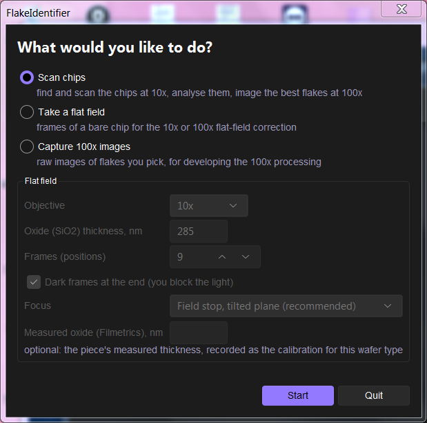

Choose **Scan chips** and press **Start**.

To look at the chips first, press **Live view...** (bottom left): a live view at the 10x scan's exposure (3 ms), with
free stage and focus control. Change the exposure in the box, or press **10x** / **100x** to use that objective's
exposure, stage steps and flat field. **Start** closes the live view.

### Step 2: objective check

If the 10x objective is not in, a window asks for it and shows in red which objective is in now. Turn the nosepiece
to 10x: **the window closes by itself** about a second after the objective is in.

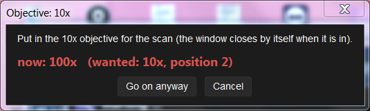

If it does not close by itself, see [the objective windows do not advance](#the-objective-windows-do-not-close-by-themselves).
"Go on anyway" continues without the check.

### Step 3: add the chips (pieces)

A live view opens. For each chip:

1. Move the stage to the **approximate centre of the chip**: the stage joystick, the arrow buttons at the bottom
   right (step size in the *Stage* box), or the keyboard arrow keys.
2. Focus roughly: the focus knob, the *Up* / *Down* buttons (step in the *Focus* box), the PgUp / PgDn keys, or
   **Autofocus**.
3. Press **Add piece N here**.

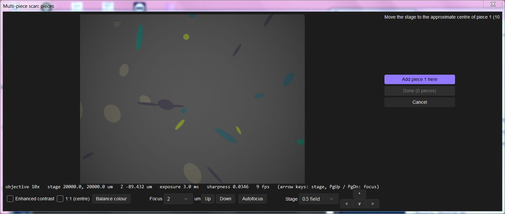

A small window asks for the chip's **material** and its **nominal oxide thickness** (90 or 285). It remembers your
last answers.

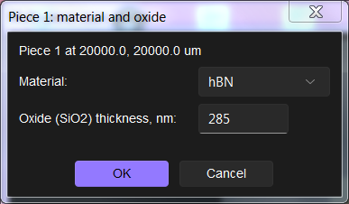

Repeat for every chip. The list on the right shows the pieces added so far. Press **Done (N pieces)** after the last one.

A chip that sits partly beyond the stage's travel (near the edge of the holder) is still scanned: the part the stage
can reach is scanned, and the log says which side goes on beyond the travel (`... the chip goes on beyond the stage's
travel: scanned up to it`). Flakes out of reach are not imaged at 100x. The first time the stage stops at a limit the
program remembers where (`stage_limits.json` in the local scan folder); the limits can also be set in the settings
(`stage_limits_um`, `[x min, x max, y min, y max]`). Move the chip towards the middle of the stage to scan the rest.

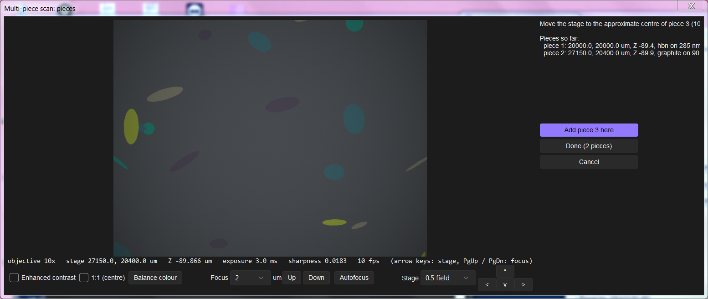

The line under the image shows the objective, the stage position and the focus (Z). Live view options: *Enhanced contrast* shows thin flakes better, *1:1 (centre)* shows the centre at full
resolution, *Balance colour* neutralises the colour of the substrate in the view (display only). *Flip left-right* and *Flip
up-down* turn the picture (display only; the arrow buttons and keys follow): both are on by default, which shows the
camera's image turned 180° (the way the stage axes and the scan plans run; setting `view_flip`). The choice is
remembered on the PC for every live view, at 10x and 100x, and for the pictures shown beside them. The chip viewer
opens turned the same way (its View row: 180°), and its 100x pictures turn with the chip map.

### Step 4: where the results go

A standard Windows folder window asks **where to save the results** (no picture: it is the usual Windows folder
picker). Choose your own folder on the share, for example `Z:\<your name>\scans`. The images are first written to
the microscope PC (`C:\FlakeScans`) and the finished results are copied to this folder at the end.

### Step 5: name the run

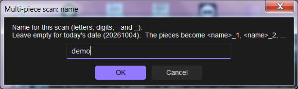

Letters, digits, `-` and `_`. Leave it empty for today's date. The chips become `<name>_1`, `<name>_2`, ... (numbering
continues if the name was used before; nothing is overwritten).

If any chip is graphite, it also asks now whether to image the rhombohedral (stacking) domains after the 100x images
(see Step 9), so that nobody has to be there to answer it later.

### Step 6: hands off while it scans

The main window shows **what the camera sees** beside the log: the last picture the scan took (10x tiles, the
autofocus frames, the 100x pictures), turned as the live views, with what it is doing, the piece, the stage position
and the focus underneath. It only shows the scan's own pictures (it takes none, so it does not slow the scan) and
changes about twice a second; **Show the camera** above it hides it (remembered on this PC; setting `show_camera`).

When the scan starts, a **Chip notes** window opens beside it (the scan does not wait for it): one chip at a time, note
the **crystal / batch**, the **exfoliation** (tape, temperature, method, date) and any **other comments**. Each chip's
boxes are filled in from the chip before (the first chip's from the last chip noted on this PC), so only what differs
needs changing. **Save, next chip** saves and moves on, **Back** returns to the chip before, **Skip this chip** saves
nothing for it. The notes are saved as `<piece>_notes.json` (copied with the chip's data to the share, even when saved
after the copy) and in the run file. `ask_chip_notes: false` in the settings turns the window off.

For each chip the program finds the edges, focuses at 9 points (4 on small pieces), plans the tiles and scans them.
Each chip's plan is saved with the results as `<piece>_plan.png` (not shown during the scan; `show_plan` in the
settings shows it): the red outline is the chip it found, the grey grid the tiles, the blue dots the edge measurements
and the green dot where it started.

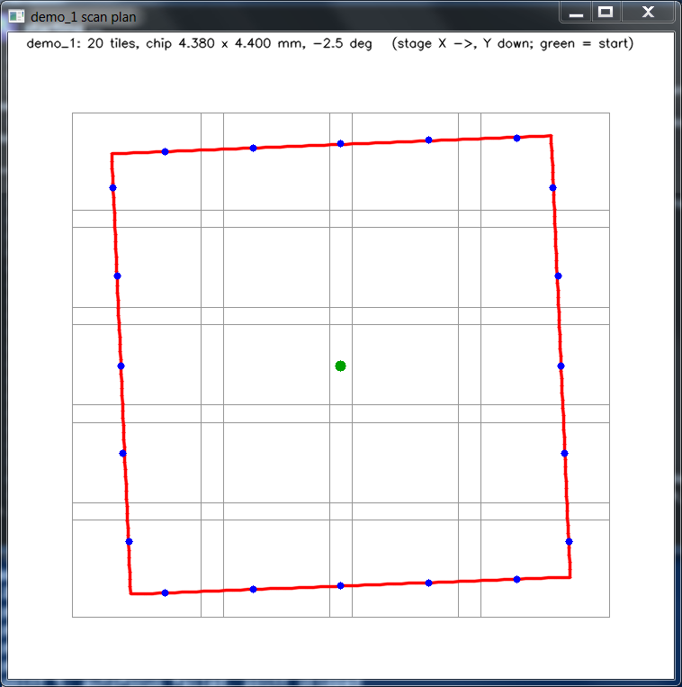

The main window shows what it is doing; **Stop the scan** stops within a second or so at any stage (it is checked
on every camera frame and while waiting), also in the middle of an autofocus.

**Focus drive at its lower limit.** When an autofocus's best focus is at the focus drive's lower limit (the sweep's
sharpest place is where the drive cannot go lower, or the best focus it found is below where the drive stops), every
picture from there would be out of focus: the scan **stops** and sends a message (Slack / email) saying so. Bring the
sample's focus nearer the middle of the drive's travel (coarse focus) or check the Oasis focus limits, then start
again. A search that only passes the limit on its way, its best focus above it, goes on (setting `focus_limit_stop`). (In the picture the
simulated chip has nothing to autofocus on, hence "autofocus failed"; on real chips the 9 points focus.)

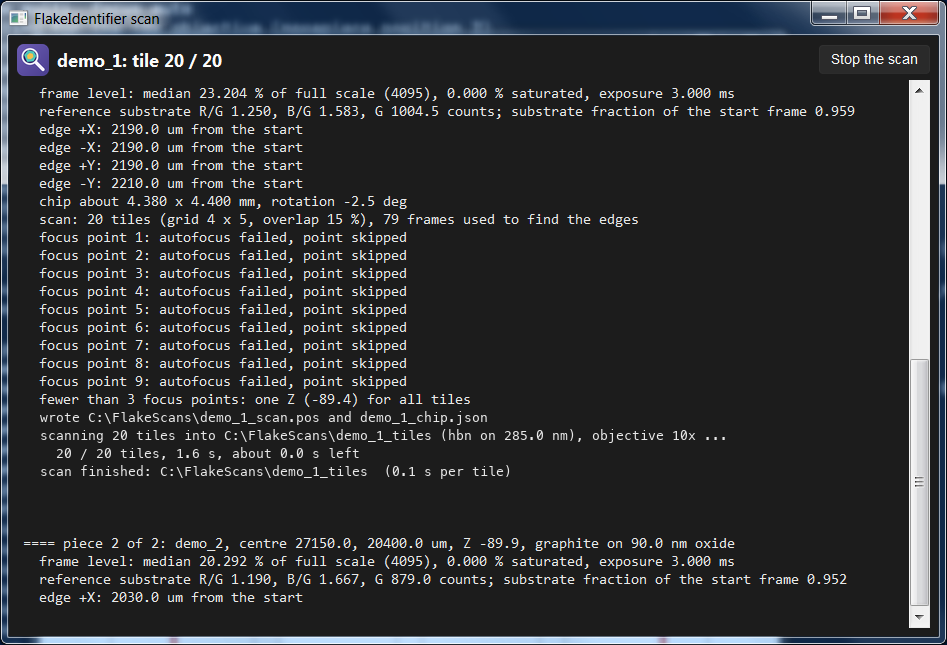

The analysis runs on the same PC while it scans. **Do not touch the stage, the focus, the lamp or the chips** until
it asks for the 100x objective. After each chip the log gives the time the 100x objective change is expected
(`the 100x objective change is expected at about 14:35`); the PC plays a sound whenever it needs you (objective change,
IR setup, a focus question; `operator_sound`).

**Pause / Resume (someone needs the microscope for a few pictures).** **Pause scan and take normal image** (the large
button next to *Stop the scan*, or **PAUSE THE SCAN** on the *Scan in progress* window, which steps aside while paused) stops the scan
at its next safe point, a few seconds at most: between two 10x tiles, focus points or edge searches, between two 100x
flakes or IR pictures, or while it waits for a target list. It notes where it is (stage, Z, objective, exposure)
and opens **Scan paused** at once (nothing is focused or moved: the check at Resume compares with the scan's last
picture; only when the scan has no picture yet with that objective it autofocuses there once as a reference):
a live view (move the stage with the joystick and focus by hand: the window has no stage or focus buttons) with
picture tools beside it (display only): **Black and white**; a **Scale bar** for the objective in use (10 µm at 100x, a round length
about a fifth of the picture's width otherwise; its length in plain white above it; on by default, its box turns it
off; the µm per pixel from the **Scale bar calibration** of that objective (Part 3), else from the
stage calibration and the objective: 10x measured on the scans, 100x the measured ratio 9.54, others 10 ÷ magnification);
**Measure**: click a first point, the ruler follows
the cursor with its length, click a second point to fix it (as many as you like; **Clear measurements** removes them);
a **histogram** of the picture's brightness with two lines to drag for the **black point** (blue) and the **white
point** (white), *Auto* (0.5 / 99.5 % of the picture) and *Reset*; **Exposure**: *Auto* (follows the picture's
brightness) or *Manual*, with ◀ / ▶ (10 % less / more) and a box to type it (*Set* or Enter). **Save image** opens the
Save dialog: choose the folder, the name and the format (JPG, PNG or TIFF); the picture is saved as shown (black and
white, contrast, scale bar, measurements) at the camera's full resolution, the TIFF with the stage position, Z,
exposure, objective and µm per pixel in its description. **Another objective** may be used: the live view's scale
follows it (read from the nosepiece, else choose it under *Objective in*). Move the stage, focus (coarse and fine
knobs), change the objective and the exposure as you like, but **do not touch the chips being scanned**. When you are
done, press **Return to the scan** (the window's only button; to end the job, use *Stop the scan* in the check window
that follows): the scan's objective is waited for (nosepiece) or asked for, its camera settings are
put back, and a **check window** opens. The stage goes to where the scan's **last picture** was taken (the last 10x
tile, or the last focused 100x picture, else the last 100x picture), with the focus drive at the reading that was in focus there; the window shows
the **live view on the left** and **that picture on the right**, each with its title above it, as large as the screen
allows, a cross in the middle of both (when the scan had no picture yet with this objective, a picture taken when it
paused is on the right). The two boxes to tick are under a white line, centred. Focus the live view (coarse
knob, then fine knob) until it is as sharp as the picture, check it shows the same place, and tick **Focus looks
good** and **Position looks good**: **Continue the scan** only then. A short autofocus refines your focus, and from
then on every focus height of the scan is offset by the change in the fine-focus reading (the log says by how much).
**The position is wrong** sends a message (Slack / email) to the person running the scan and keeps the scan paused
(until it is checked, or stopped). Without a picture of the scan yet with this objective, the check is where the scan
paused, at the focus it measured there before the pause. *Stop the scan* in the window ends the job. Closing the window does nothing (Resume or Stop). Settings: `pause_refocus`, `pause_refocus_tol_um` (10x, 100x;
smaller changes are ignored), `pause_refocus_warn_um`.

### Step 7: switch to 100x

After the last chip the program asks for the 100x objective.

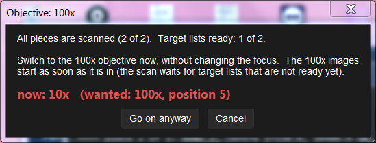

It also says how many chips' flake lists are ready. Turn the nosepiece to 100x **without touching the focus knob**.
The window closes by itself and the 100x images start; lists that are not ready yet are waited for.

### Step 8: 100x images

The program visits the best flakes of each chip, focuses and takes images. While a chip's flake list is not ready
yet, it waits for the analysis (the waiting window can be ignored).

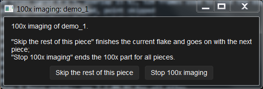

- **Skip the rest of this piece**: finish the current flake and go to the next chip.
- **Stop 100x imaging**: end the 100x part for all chips (the results are still saved).

If autofocus fails on the first flakes of a chip, it first searches ±80 µm around the expected focus (a focus drive
that has slipped; see Part 2); only then a live view asks you to focus by hand. Beside the live view it shows a 10x
picture of the flake from the scan, with the 100x field boxed: check the stage is on that flake (if not, move to it),
focus, then **Use this focus** (*Skip* leaves this flake out, *Stop* ends the 100x part). Unanswered, it uses its own estimate
after 2 minutes (the countdown is shown), and asks no more focus questions on that chip (`focus_dialog_repeat`). Flakes
it could not focus are imaged at the estimate and tried once more at the end of the chip, when a flake after them was
focused (`retake_failed`; the log says `retaking ...`); a retake replaces the first image. A retake **searches harder**:
after the usual searches, ±40 µm in 2 µm steps, moved on up to twice when the focus is at an end (±120 µm; settings
`af_retake`, `af_retake_extend`). During the retakes the 100x window's **Manual focus (retakes)** button (greyed out
the rest of the time) hands a flake to you: the current one if the autofocus does not find it, else the next one, in
the focus-by-hand window (fine knob; *Skip*: imaged at the estimate).

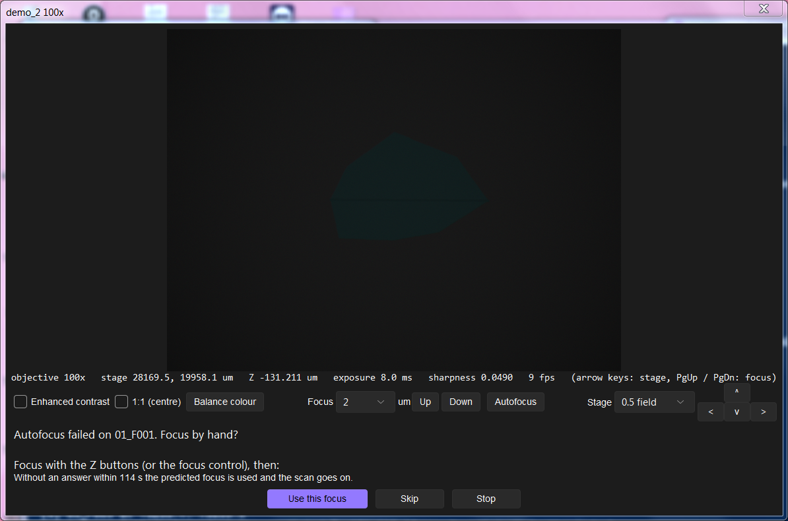

**Two thickness readings, decided at 100x.** Some hBN colours fit two thicknesses about equally at 10x (e.g. ~25 and
~156 nm on ~295 nm oxide: flagged `two_branch`, the thin one reported). At 100x they look different (thin: red about
−0.5 against the substrate, thick: about −0.1), so the 100x export compares the terrace's 100x colour with the
thin-film model's 100x colour of each 10x reading and keeps the one it fits, when that is clear (`branch100` in the
picture's `_regions.json`; the viewer shows the chosen thickness, the other reading as its alternative and
`100x_branch` in its quality; the designer uses it, so a flake found ~156 nm is left out as too thick). The thickness
itself is still the 10x fit: the 100x picture only chooses between its readings. Viewers exported before get it with
`hundred --viewer <chip>_tiles_viewer --score100`.

The 100x images are named `<chip>_F<flake>_<thickness>_100x_<order>.tif` (the IR images `..._IR_<order>.tif`), e.g.
`20261013_1_F001_15nm_100x_001.tif`, so a folder of them sorts by chip, then flake; the viewer's JPEGs keep the same
names. (Runs before 2026-10-19: `<order>_<rank>_F<flake>_<thickness>.tif`.)

**Mosaics of large terraces.** When a flake's chosen terrace (the uniform region it was picked for; its outline is in
the target list since 2026-10-19, `terrace_poly_um`) is larger than one 100x field (~157 × 119 µm), the program takes
the main, centred picture as always and then the other fields the terrace reaches into, 15 % overlapping
(`hundred_mosaic_overlap`), row by row. Each field takes the main picture's focus plus the chip's tilt (the fields are
within a few hundred µm of it; `hundred_mosaic_af` can add a short sweep per field); `hundred_frames` frames averaged,
no shifted frames. They are saved as
`<main picture>_m02.tif`, `_m03.tif`, ... and listed in `<chip>_100x/<chip>_100x_mosaic.csv` (file, stage X/Y/Z, how
focused). At most `hundred_mosaic_max_tiles` (8) pictures per flake (the ones nearest the main picture), and at most `hundred_mosaic_budget_min` (20) minutes
of extra imaging per run: after that the remaining flakes get their single picture (the log says so). For graphite the
IR picture of such a flake is a mosaic too (`<IR picture>_m02.tif` ..., `<chip>_domains/<chip>_domains_mosaic.csv`; its own
budget `domain_mosaic_budget_min`, 10 minutes; the IR field size from `domain_px_um_matrix`, which the Domain camera test
saves). The export stitches each mosaic (positions from the stage, corrected by matching the overlaps; brightness matched)
into `<main picture>_mosaic.jpg` (IR: `_mosaic.png` 16-bit + `_mosaic.jpg`); in the viewer, **W** (or the *mosaic* /
*IR mosaic* buttons) shows the whole terrace; in the designer's 100x picture window, **Whole terrace** (key **M**) shows
the mosaic around the picture at the same scale (100 %: the usual view), the mouse wheel or − / + / *Whole* zooms out,
dragging moves it. `hundred_mosaic: false` turns it all off. Target lists written before
2026-10-19 have no outline: single pictures as before.

### Step 9: graphite only, stacking domains

For chips entered as graphite it asked at the start (Step 5) whether to image their rhombohedral domains with the IR
camera (the window below; with `domain_imaging` set to `"ask"` outside a multi-chip run it is asked here, with the number of
flakes of 3 or more layers imaged).

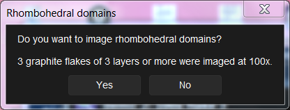

**No** skips it. **Yes** asks you to change to the IR objective and camera without touching the stage or focus.

Each flake is then focused with the IR camera: the first one with a wide search (the IR-100x focus offset is learnt
there), the others with one sweep of +-4 um around the predicted focus, the focus taken from a fit through it
(`domain_af_fit`; about 1.5 s a flake). The IR pictures change little with focus (several um depth of field, low
contrast), so the earlier test on the sweep's peak against its median failed on 3 of 4 flakes and fell back to the wide
search; the sweep is now accepted when its sharpest point is inside and 3 % (`domain_af_min_rise`) above both ends.

### Step 10: finished

As soon as the microscope work is done the start screen is back: **set up the next job right away**. The run's
100x export (into the viewers) and the copy to the share go on in the background at a lower priority, so the next
scan comes first. A progress bar under the status line shows how far it is (`previous run <name>: chip 2 of 4 ...: 100x
pictures 12 of 30 exported, about 3 min left`). With the Slack bot you get two messages: **scanning finished** (the
microscope is free) and **export finished** (with where the results are). Re-imaging a chip whose
export is still running is refused until it is done. Closing the program waits for the export and the copy to finish
(the window says so). `export_in_background: false` in the settings waits at the end of each run as before.

When the analysis has finished, the program returns to the start screen for the next job; the results are copied to
your folder in the background. **Quit** when you are done; it waits for the copy to finish before it exits.

**Start screen** (next to Stop in the main window) goes back to the start screen at any time: during a job it asks,
then stops the job at its next safe point (as Stop does) and opens the start screen; after a job that was stopped,
cancelled or failed it starts the next job (the main window then offers **Start screen** or **Close**).

**The results**, in the folder you chose, under `<name>_run_<n>`:

| what | where |
|---|---|
| the chip viewer (map, flakes, 100x images) | `<chip>\index.html` (or `<chip>\<chip> viewer.html`) |
| 100x images | `<chip>\100x\` |
| target list, flake tables | `<chip>\data\` |
| designer bundle (load in the vdW Stack Designer) | `designer\` (built by the designer, see below) |
| copy finished marker | `copy_done.json` |
| the full log | `<name>_run_<n>_log.txt` |

The microscope PC no longer builds the designer bundle (that was the slowest part of a run's export). When the copy to
the share is finished the program writes `copy_done.json`; the vdW Stack Designer on any office or stacker computer
then builds `designer\` in the background and shows the run. To build on the PC as before, set
`designer_on_pc = True` in the settings.

In the viewer: arrow keys move between flakes, `L` swaps the large 100x view and the map, keys `1`-`8` switch the
100x view (natural, high contrast, ...), `I` swaps it with the flake's IR (stacking-domain) picture laid over the 100x
frame (graphite runs with domain images), `Esc` closes it. The designer's 100x picture (Library: View) has the same
IR view: the **IR domains** button or `I`.

**How the pictures look** (from 2026-10-27, `flakeid.look`): the pictures you look at are shown with the colours of a
reference 100x picture (hBN on 285 nm oxide): the substrate at (176, 122, 148), bright flakes rolled off without
changing their hue instead of clipping. These are separate copies: `<picture>_look.jpg` (and `_avg_look`,
`_mosaic_look`, `preview/…_look.jpg`) next to each 100x picture and the viewer's `tiles/look` layer; the viewer
(*Scan*, the 100x *natural* view), the summary picture and the designer (100x picture, cut-outs, chip overview,
thumbnails) show them. The analysis, the thickness and every measurement read the original, linear pictures, which
are unchanged: the viewer's **Linear** button (map) and *linear* view (100x) show those.

**The page** (from 2026-10-27): on the right, the name, the number of flakes, the thickness colours, then one row of
buttons, the table and the selected flake's details.
- **Image options** (opens when the mouse is on it): the map's picture (*Scan*, *Linear*, *Enhanced ×3*), *Outlines*
  and *Labels*, the orientation (rotate, mirror) and the coordinates (*Set origin*, *Align X*, *Measure*, *Clear*), and
  the keys.
- **Filter** (click): *Only flakes with 100x images*, the thickness (flakes with a terrace in the range), the flake area,
  the 10x score and the 100x score. The button shows how many filters are on (*Filter (2)*); *Reset filters* or *clear
  filters* (under the buttons) removes them. The line under the buttons says how many flakes are listed, e.g. *834 of
  3435 flakes shown* (flakes with no terrace in the page's thickness range are never listed).
- **Sort** (click): by 10x score, 100x score, thickness, flake area, best terrace Ø, number of terraces, flake number (or
  X, Y once an origin is set), highest or lowest first. Clicking a column's name sorts by it as before (again: the
  other way round); the button and the column show the sort.
- The table's first column, **#**, is the row's place in the current order and filters (1, 2, 3, …), whatever the sort.
- **The selected flake's 100x picture** is at the bottom right of the map. **Hide** removes it when it covers part of
  the map; **Show 100x** brings it back (remembered). Click the picture for full resolution; the mouse on it shows its
  statistics (terrace, debris, clean area). The coordinates (origin, measured points) are shown at the top right of
  the map while they are in use.

Clicking a terrace under *Terraces* closes the large 100x view, zooms onto the terrace and outlines it in cyan. A
strip under the map holds the scale bar and cursor position (left) and the 100x views (natural, linear, colour ±8 %,
…; keys `1`-`9` as before, middle). Existing viewers get the new page with
`python tools/upgrade_viewers.py "<run folder>"` (their data, tiles and 100x pictures are kept; the old page is kept as
`index_before_upgrade.html`).

**10x score and 100x score.** The *10x score* (0–1) is learned from your labels of which flakes were worth imaging and
uses the 10x scan only; it chooses the 100x targets. The *100x score* (µm², from 2026-10-27, `screen100.clean_score`)
is measured on each 100x picture: the area of the **largest connected part of the terrace with no step edge, glue /
debris, bubble or fold** (0.5 µm away from each, 1 µm from the terrace edge); a flake's 100x score is the best of its
pictures, and a picture that missed the flake (bare substrate) scores 0. The *debris* view outlines the scored area in
green. **100x mode** (the row of buttons) shows only the flakes with 100x pictures, ranked by the 100x score, the picture large
(arrow keys: next / previous; again or `Esc` to leave); the table has both scores and a *100x score ≥* filter.
Viewers exported before the 100x score get it with
`C:\FlakeID\run_flakeid.bat hundred --viewer <chip>_tiles_viewer --score100` (from the 100x JPEGs).

To match how the chip sits under another microscope or the AFM, *Orientation* under **Image options** rotates the chip map (`R` / `Shift+R`:
90° clockwise / counter-clockwise, or type any angle) and mirrors it (`H` left-right, `V` top-bottom; `0°` resets);
outlines, labels, clicks and the small chip map in the large 100x view follow. For positions in µm from a feature of
the chip, click **Set origin** (`O`, under *Image options*) and then the feature (e.g. a chip corner): the cursor read-out (bottom left), the
table (X, Y columns) and the flake details then give X, Y in µm (0.1 µm) from it, with +X right and +Y up *as
displayed*. **Align X** (`X`) and a click on a second point along a chip edge fixes +X along that edge (+Y 90°
counter-clockwise of it, as displayed then), so the coordinates stay in the chip's own frame whatever the view;
click **Align X** again to go back to the view axes. **Measure** (`M`) marks points A and B: their coordinates (with
copy buttons) and the distance between them; `Esc` ends it. The view, origin and axis are remembered per page (in the
browser). Existing viewers get this with `zoomview.upgrade_page`.

An older viewer gets the IR view with `python -m flakeid.hundred --viewer <piece>_tiles_viewer --align-ir` (it also
redraws the IR pictures at the current contrast range and marks the run for the designer to rebuild).

A run of two chips takes roughly 30-50 minutes (most of it unattended).

---

## Part 2: mistakes that cause problems

| mistake | what happens | how to avoid it / fix it |
|---|---|---|
| **The desktop icon does nothing** | A previous session of the program has not exited (invisible, but it still holds the camera or the nosepiece port), so a new start waits. | Task Manager (Ctrl+Shift+Esc) → Processes → end `pythonw.exe`, then start again. |
| **Micro-Manager or Olympus Stream left open** | The program cannot open the camera or stage, or cannot read the nosepiece (log: `WARNING: nosepiece not read`); then the objective windows do not close by themselves. | Close them before starting. |
| **Measured oxide entered instead of the nominal one** (for example 82 instead of 90) | The program converts nominal values to measured ones itself (90 → 82 nm, or your Filmetrics calibration); an entry that does not match a known nominal value is used as it is, so thicknesses and layer numbers can be off. | Enter what is on the wafer box: 90 or 285. |
| **Wrong material** | hBN analysed as graphite (or the reverse): wrong thicknesses and a useless target list. | Check each piece in the list before pressing Done. |
| **Tape over the chip's edges or corners** | Focus points landing on the tape focus tens of µm too high and tilt the focus plane (blurred tiles). | Handled: a focus point must be on bare substrate (else it moves towards the centre, `focus_min_substrate`, `focus_moves`); one far off the plane through the others is refocused further in, and the plane is fitted to the points that agree (`focus_outlier_um`, 8 µm); the log says which points were left out. Best: keep tape off the chip, or only on its very edges. |
| **Chips close together or touching** | The edge search stops before the next chip (its outline once scanned, else where it was added). A narrower dark gap there (20 µm or more, `narrow_gap_um`) is taken as the edge (log: "a narrow gap before the next chip ... taken as the edge"); with no gap at all a window with the live view asks you to put the cross on the chip's edge ("The edge is at the cross"; you get a Slack / email message). | Best: leave holder visible around each chip. Two chips added within 1 mm of each other are refused. `edge_ask = False`: the piece fails instead of asking (unattended runs). |
| **Piece added off the chip** (on tape, the holder, or the very edge) | The program cannot find the substrate colour or the edges; the piece fails. | Add each piece near the chip's centre, on bare substrate. |
| **Far out of focus when adding a piece** | The 10x autofocus searches about ±30-90 µm; further away it fails or focuses on dirt. | Focus roughly before pressing Add piece. |
| **Touching the stage, focus, lamp or chips during the scan** | Tiles out of focus, shifted or with different colours; the stage check can stop the run (`more than ... from the target`). | Hands off until the 100x prompt. |
| **Touching the focus when switching to 100x** | The 100x focus is predicted from the 10x focus (100x = 10x − 42 µm). If it is off, the first flakes need a wide search or your help. | Turn only the nosepiece. |
| **The chip shifts during the objective change** (or the 100x positions are off for another reason) | 100x images miss their flakes; autofocus fails on most of them. | Start screen → *Re-image 100x targets*: it finds the chip again from its flakes and re-images them (Part 3). |
| **Chip put back turned around** (re-imaging) | The chip is not found ("no spot matched the flake list"). | Put it back the same way round as when it was scanned (within ~8°). |
| **Changing lamp brightness, aperture, field stop or filters** between flat field and scans | Colours change, so the thickness of every flake shifts; flat-field correction leaves stripes or spots. | Keep the standard settings. After a flat field, **reopen the field stop**. Retake the flat fields after any change to the light path. |
| **Field stop left partly closed** | Dark edges in every image, as if the chips had dark borders; false thicknesses at the image edges. | Field stop fully open for scans. |
| **Results folder on a disconnected share** | The copy at the end fails (log: `copying the results ... failed`); the results stay on the PC. | Copy them later from `C:\FlakeScans\results\<run>`, or reconnect the share before starting. |
| **Closing the main window during a scan** | The scan stops; what was scanned so far is kept, the run is marked stopped. | Use **Stop the scan** (stops after the tile) and wait. |
| **C: drive full** | Tiles cannot be written; the run stops. | The program deletes raw tiles after a run; old capture and flat-field folders in `C:\FlakeScans` can be deleted. |
| **Leaving a question unanswered** | Focus questions close after 2 minutes and use the program's estimate; no more focus questions on that chip, its unfocused flakes are retaken at its end. Objective windows wait. | Nothing to do, but check the log for flakes marked `predicted`. |
| **The focus moves by itself during the 100x imaging** (a slipping focus drive) | The 100x focus is suddenly 5-60 µm away from where the flakes before predict it (20261014_run_1: 40-60 µm). After two flakes in a row without focus (or before a focus question) it searches ±80 µm once (`long search` in the log); a clear focus that it finds twice is kept, it logs `FOCUS JUMP`, focuses the next flakes from there and retakes the flakes missed before it at the end of the chip; a summary at the end lists all jumps. | If the log shows focus jumps, check the focus drive's coupling on the focus knob and the coarse-focus tension. Re-image the retake list. |
| **Unusual objective in place** (not 10x / 100x) | The objective window waits. | Put in the right objective. |

### The copy to the share takes long

What takes time is the number of files, not their size. The chip viewers' map is cut into tiles at every zoom level;
since 2026-10-27 the tiles are 1024 px (were 256): a 1 × 7 cm piece's viewer has ~1,900 tile files instead of ~27,000.
Viewers made before keep their 256 px tiles (everything that reads them takes the size from the viewer).

### The copy to the share was interrupted

If the program was closed (or the share dropped) while it copied a run's results, the run on the share has no
`copy_done.json` and may be missing files; the results are complete on the microscope PC. Copy it again (files already
there are skipped):

    C:\FlakeID\python38\python.exe -m flakeid.scope.copyrun <run name> --settings C:\FlakeID\scan_settings.json

e.g. `graphite_20261019_run_1`. When it is done the designer builds the run (restart the designer if it had already
tried).

### The program does not start

While it opens the microscope (Micro-Manager starts the camera, the stage and the other devices) a **Connecting to the
microscope** window shows the time so far and Micro-Manager's latest messages (which device it is starting); a quick
start shows no window. Micro-Manager's log of the start-up goes to `C:\FlakeScans\mm_startup_log.txt`. **After a restart
of the PC** a device may not answer until another program has started it: after 45 s the window says so. Press
**Quit**, start **Stream Motion**, wait until it shows the live picture, close it, and start the scan program again
(*Keep waiting* waits another minute). If it keeps happening, send `mm_startup_log.txt`: it shows which device does not
answer.

If a second copy of the scan program is started while one is still running (e.g. one finishing a run's export after
its window was closed), a message says so: wait for it, or end `pythonw.exe` in the Task Manager. Otherwise look at
`C:\FlakeScans\flakeid_console_log.txt`: the last lines say how far it got (`loading the microscope ...` without
`microscope ready`: Micro-Manager could not load the hardware; try the configuration in Micro-Manager itself, and
power-cycle the cameras). Starting `C:\FlakeID\run_flakeid.bat` from a Command Prompt shows everything as it happens.

### The program closes by itself

If the scan program's windows vanish without an error message, Python itself crashed (usually inside a device driver).
Every start writes `C:\FlakeScans\crash_log.txt`: after such a crash it ends with the stack of every thread, which shows
what the program was doing. Send it together with `C:\FlakeScans\flakeid_console_log.txt` and the run's log.

### The camera gives no pictures (Error in device "16501874" ... (25))

The camera (`16501874` is the XC10's serial number) still answers but refuses to take pictures: the log shows `camera
stream not usable: ... Unknown error in the device (1)`, then `Error in device "16501874": (Error message unavailable)
(25)` (25 is Micro-Manager's general "taking the picture failed"). Since 2026-10-27 the program then **reconnects the
camera by itself** (Micro-Manager closes and opens it again, the software way of unplugging it; up to 2 tries, at most 10
in a job), puts its settings back and goes on; the log says `reconnecting it` and `reconnected, it gives pictures again`,
and lists the camera's properties at the first failure. If that does not help, the job stops with what to do: close the
scan program and every other program that can use the camera (Stream Motion, XCAP, XIMEA CamTool, xiCOP), unplug the
camera's cable from the PC for 10 s, plug it back in and start again; if it still fails, restart the PC.

### The objective windows do not close by themselves

1. Close the scan program, then run `C:\FlakeID\run_flakeid.bat objtest` and follow it (it shows every nosepiece
   position as you turn it, then opens the program's objective window). It writes `objective_test_log.txt`.
2. Look in the run's log for `nosepiece` near the start. `WARNING: nosepiece not read` means another program had
   the port (Olympus Stream, Micro-Manager, or before 2026-10-04 a previous job of the program itself).
3. `C:\FlakeID\scan_settings.json` must have `"nosepiece_port": "COM1"` and
   `"objective_positions": {"10x": 2, "100x": 5, "domain": 3}`.

---

## Part 3: other jobs on the start screen

### Take a flat field

A flat field corrects uneven illumination and dust in the light path. One is needed for 10x and one for 100x **per
oxide** (90 and 285 nm). Retake them after cleaning or adjusting the optics, changing the lamp, or when the viewer
shows spots or stripes that are the same in every image.

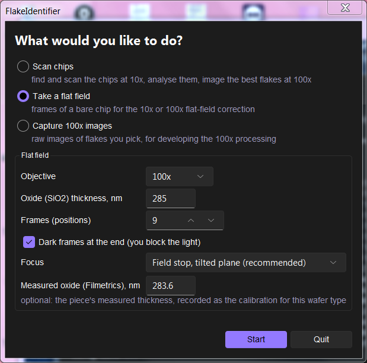

1. Start screen → **Calibrations and tests** → **Take a flat field**. Choose the objective and the nominal oxide; leave Frames (25) and Dark frames.
   **Focus: Field stop, tilted plane** (the default; required at 100x).
   If the piece's oxide was measured with the Filmetrics, enter it in **Measured oxide** (see
   [oxide calibration](#oxide-calibration-filmetrics)).
2. Put a **bare** piece of that wafer under the objective (no flakes, no tape residue).
3. The live view asks you to move to a clean area and **close the field stop** on the illuminator until its edge
   (a polygon) shows in the view, then focus on that edge and press **Use this focus**.

   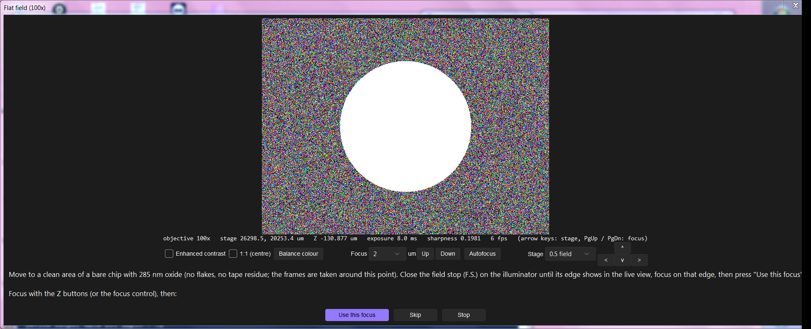

   (Simulated: the bright disc is the light inside the closed field stop.)

   Bare substrate has nothing to focus on: autofocus there focuses on dust in the light path, which comes into focus
   a few µm away from the surface. The field stop's image lies on the surface and is sharp only when the surface is.
4. The program focuses on the edge at 5 points and fits the chip's tilt, then asks you to **open the field stop
   again** to the scanning setting (fully open).

   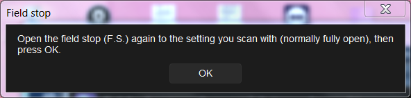

5. It takes the frames, then asks you to block the light for the dark frames (close the lamp shutter, or switch the
   light path away from the camera), then OK.

   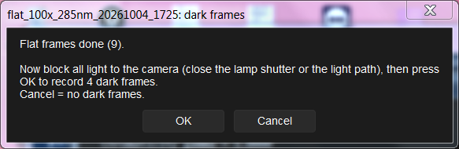

6. It shows the new flat field and, if there is one in use, its change from that one, and a summary:

   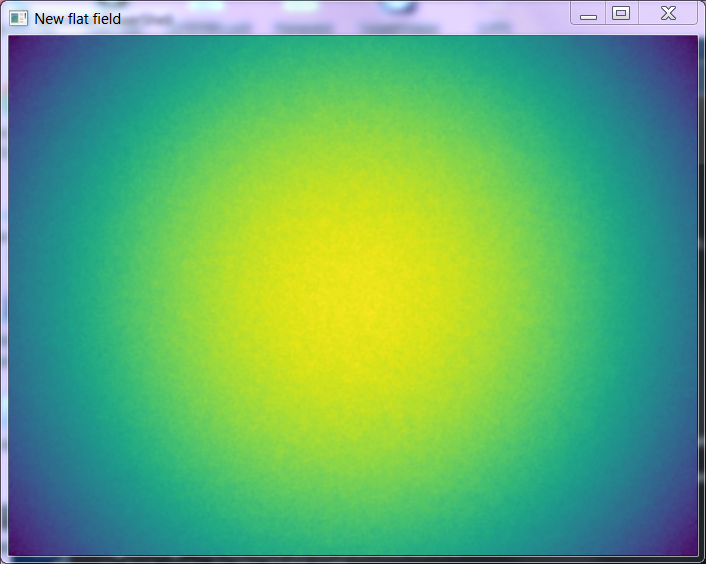

   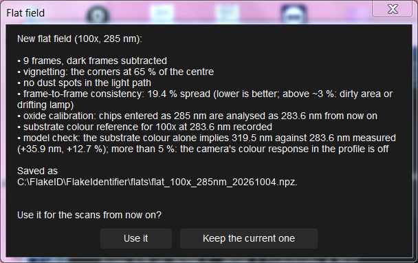

   (The numbers in this picture are from the simulator: a real flat field has a frame spread of a few % and, with a
   good colour calibration, a model check within a few %.)

   - **Use it** makes it the one the scans use (the settings file is updated; a backup of the old settings is kept);
     **Keep the current one** saves it without using it.
   - Check: the focus plane's residual below ~0.4 µm (log), **no warning "the spots get deeper across the grid"**
     (frames out of focus), few dust spots, frame spread below ~3 %.

**IR flat field (stacking-domain camera).** Choose the objective **IR (domain camera)** (Focus: field stop, as for the colour flat
fields). The program waits for the IR objective (nosepiece position of `"domain"` in `objective_positions`) and switches
to the IR camera straight away (the dialog's title names it); put the IR illumination and filter in place, move to a
clean area of a bare chip, focus on the substrate in the IR picture and press **Use this focus**. Then close the field
stop when asked: its edge is focused at the centre and four corners, the IR pictures are taken on that tilted plane, and
you are asked to open the field stop again. No dark picture is taken for the IR camera: its automatic level control would read it at another
gain (an earlier IR flat's dark put a band into every domain image). The program takes an averaged IR picture at each position (Frames) around that point, takes the
median of them and saves `flat_fields\flat_domain_<date>.npz`. **Use it** puts it into the settings as `flat_domain`;
from then on the domain images are divided by it when they are exported, so their grey levels are contrast to a flat
substrate. Take a new one after any change to the IR light path.

### Re-image 100x targets

When the 100x images of a chip went wrong (positions off because the chip moved during the objective change, autofocus
failing on most flakes), or a chip was taken off and is put back later: start screen → **Re-image 100x targets**.

Every 100x run writes a **retake list** for each piece, `C:\FlakeScans\<piece>_retake.csv`: the targets without a
focused image (focus not found, skipped, or not imaged), with the reason in its last column ("retake list: 16 of 80
targets without a focused image" in the log). A re-image run keeps it up to date (it then lists what is still missing).

1. Choose the piece. Tick **The chip was taken off and put back** if it was; tick **Only the flakes without a focused
   image last time** to image only the retake list (without a list, the targets without a focused image in the first
   run's 100x index, matched by position). Leave **Align by centring 3 flakes by hand at 100x** ticked.
2. Put the 10x objective in. If the chip was put back: put it back **the same way round**, move anywhere onto it
   (bare substrate near the middle is best) and focus when asked; the program then finds the piece's edges again for a
   first estimate of where it is.
3. Switch to 100x when asked. The program picks 3 target flakes far apart on the piece (thick ones, which are easier to
   see), moves to where the first should be and shows the live view with a cross in the middle, and beside it the 10x
   picture of the flake with the 100x field boxed. Move the stage (joystick, the arrow buttons or the arrow keys) until
   the live view shows what is in the box, centred on the cross; focus; press **Use this position**. If you cannot find
   a flake, **Skip** picks another. After the first flake the others are much closer to where the stage stops (the
   log says how far each was from where it was expected), and a picture of each centred view is saved
   (`<piece>_retakeN_alignK.jpg`).
4. From the 3 flakes it works out how far the chip moved and turned ("aligned by hand on 3 flakes: the piece moved
   ..., rotated ...; the flakes agree to 1.8 µm rms"; a warning above 8 µm: one flake was probably not the right one),
   then images the targets at their new positions, with the focus of the 3 flakes as the starting point.
5. At the end it updates the results everywhere: the new images go into the chip's viewer, each replacing that flake's
   earlier image (a focused one always; an unfocused one only an earlier unfocused one); the run's designer run is
   rebuilt (the designer uses each flake's focused image); and the chip's folder and the designer run are copied over
   the run's copy in the results folder (the share), only the files that changed. Where that copy is, it asks right
   at the start of the re-image the first time for a run (choose the run's folder, e.g. `scanresults\20261007_run_2`,
   or the folder it is in) and remembers it in the run file. The images are matched to their flakes through the
   shift and rotation found in step 4 (the log says "80 of 80 images matched"). In the vdW Stack Designer, reload the
   page to see the new images; keep / discard decisions, drawn terraces and stacks keep their flakes.

**Re-images made before this was automatic** (or when the copy failed, e.g. the share was not connected): start screen
→ **Re-image 100x targets**, choose the piece, tick **No imaging: only update the viewer, designer run and results
folder from the re-images done**, Start. It does step 5 for all the piece's re-images (in order; doing it again changes
nothing) without using the microscope. The log is `C:\FlakeScans\<piece>_update_log.txt`.

Without the tick in step 1 the chip is found automatically: its edges, then 10x frames at several spots compared with
the first scan's 10x mosaic, then a 100x check of the first targets and re-centring each target against the mosaic
(pictures `<piece>_retakeN_spotK.jpg`, `_check100_K.jpg`). This was not reliable on real chips; use it only to try it.

It needs the first run's files on the microscope PC (`C:\FlakeScans\<piece>_targets.csv`, `<piece>_chip.json`,
`<piece>_targets_crops\` for the pictures, and for the viewer the analysis results in `C:\FlakeScans\results\`).

### Capture 100x images

Raw 100x images of flakes you pick, for developing the 100x image processing (nothing is deleted).

Start screen → **Calibrations and tests** → **Capture 100x images**, with the 100x objective in. For each flake: move to it in the live view,
focus, **Use this focus**; it takes the frames and frames around it; then **Capture another flake?**

The images are in `C:\FlakeScans\capture_<date>_<time>\`.

### Device photos

Photos of a finished device or heterostructure at every magnification, for records and papers.

Start screen → **Device photos**:

- **Stack folder**: the device's folder (e.g. `<share>\<your name>\Devices\<device>`; **Browse...**), the one the
  vdW Stack Designer keeps the stack in. Remembered for next time. The device name shown is the folder's `.stack`
  file's name (else the folder's name). A folder that does not exist yet is made when you press **Start** (you are asked).
- **Step**: the fabrication step's short name, e.g. `contacts`, `SETs`, `tgetch`. It becomes part of the file names
  (spaces and other signs become `_`).
- **What was done**: a few lines (recipe, thicknesses, anything worth remembering); it can be edited later in the
  designer.
- **Oxide (SiO2) thickness, nm**: the chip's oxide (sets the photos' white balance).

**Start**. The program asks for the objectives in turn: **100x, 50x, 10x, 5x**. For each: put the objective in (the window closes by itself once
the nosepiece reads the right position), centre the device in the live view, focus, **Take photo**. **Skip** leaves
that magnification out; **Stop** ends the photos (those taken are kept and processed).

- 100x and 50x are taken like the scan's 100x pictures of flakes: 16 frames averaged, then 8 frames at each of four
  positions 10 µm (100x) or 20 µm (50x) to the side. The pictures are aligned on the device and combined, so dust in
  the light path and camera specks average away. This takes about half a minute per photo; keep still.
- 10x and 5x: 4 frames averaged at one position.
- Each objective keeps its own exposure, set for the device's substrate level.
- 50x and 5x are not in the settings file the first time: you are asked to put them in and press **Continue**, and the
  nosepiece position read then is remembered (`objective_positions`).

After each photo the program shows it (white-balanced, the shifted pictures combined) with what it checked: whether
the shifted pictures aligned (if not, something moved or the focus drifted), saturated pixels, and a sharpness number
to compare retakes. **Keep** goes on, **Retake** takes it again (refocus first if needed; the first try is deleted),
**Stop** ends the photos.

With the objective offsets measured (below), the stage and focus follow each objective change, so the device stays
centred and nearly in focus; the photos' scale bars then use the measured pixel sizes.

After the four, **Another picture?** offers the objectives again: take as many extra pictures as you like, at any
magnification, when a field of view leaves out something; **Done** finishes.

Then the pictures are made into photos (white-balanced like the scan's 100x pictures, 10x and 100x flat fields
applied), and at 100x the device's **terraces** (areas of one colour, i.e. one stack of layers, of at least 12 µm²)
are found: each gets a **high-contrast frame**, colour ±8 % around that terrace's colour, which shows bubbles,
wrinkles and residue on it. This is done on the microscope PC in a working folder,
`C:\FlakeScans\device_photos\<device>_<step>_<date>_<time>\`, then the step is written to the stack folder as
`NN_<step>\` (NN = the next number: `01_stacking` is the stacking, so the first fabrication step is `02`):

| file | what |
|---|---|
| `<device>_<step>_100x.jpg`, `_50x.jpg`, `_10x.jpg`, `_5x.jpg` | the photo of each objective |
| `<device>_<step>_100x_2.jpg`, `_100x_3.jpg`, ... | extra pictures at that objective, in the order taken |
| `<device>_<step>_100x_terraces.jpg`, `<device>_<step>_100x_T1.jpg`, ... | the 100x terrace map and the terraces' ±8 % frames (of an extra 100x picture: `<device>_<step>_100x_2_terraces.jpg`, `<device>_<step>_100x_2_T1.jpg`, ...) |
| `<device>_<step>.html` | the step's page: every photo (scale bars), what was done, the terrace maps and tables |
| `step.json` | the step for the designer (name, description, date, who, oxide, the photos and terraces) |

Once every file is in the stack folder (checked: present, full size), the raw TIFFs and the working copies are deleted
from the microscope PC; the working folder keeps its log and lists. **Open the page** shows the step's page.

If the stack folder cannot be reached (the share is down), nothing is deleted: everything stays in the working folder
and the program says so. Send it later from the microscope PC (`C:\FlakeID`):

    python38\python.exe -m flakeid.scope.devicephotos --resend "C:\FlakeScans\device_photos\<working folder>" "<stack folder>"

(the photos are processed first if that had failed: add `--flat10 ... --flat100 ...`; `--step` and `--description`
change them).

In the vdW Stack Designer, open the device's stack folder: its **Fabrication** view lists the steps (found by their
`step.json`); the description can be edited there.

Without a stack folder (settings files without the start screen, `device_stack_dir` empty), the old way: the folder
`C:\FlakeScans\device_photos\<device>_<date>_<time>\` (raw TIFFs, `photos\`, a page) is copied to `device_photos`
next to the results folder on the share (`device_photos_to`), and imported in the designer with **Import device photos…**.

Processing again (e.g. with another flat field): `python -m flakeid.devicephoto <folder> --flat10 ... --flat100 ... --oxide 285`.

### Objective offsets

Where the same feature is with each objective (stage X / Y and focus), and each objective's real pixel size and
orientation. Do it once, and again after an objective is moved or changed.

Start screen → **Calibrations and tests** → **Objective offsets**, choose the reference objective (100x by default) and put it in, **Start**. Centre a
small, sharp feature on the cross, something with edges in X and Y that is also visible at 5x (the corner of a large
flake works well), focus, **Use this position**. The program then asks for the other objectives in turn, from the
reference down (100x → 50x → 10x → 5x; a reference in the middle measures down, then up). For each: change the objective
**without touching the stage or the focus**; the program focuses (a wide search), measures the pixel from small stage
moves, finds the feature by matching its picture with the previous objective's, and moves there. Check that the feature
is on the cross (the previous objective's picture is shown beside the live view); if not, centre it and press **Use this
position**; **Skip** keeps the automatic result.

At the end it lists the offsets and pixel sizes and asks whether to write them into the settings (`objective_offsets`).
The pictures and `objoffsets.json` are in `C:\FlakeScans\objoffsets_<date>_<time>\`. Objectives the settings do not
know yet (50x, 5x) are asked for by name, and their nosepiece positions remembered.

### Scale bar calibration

The µm per camera pixel of each objective, for the scale bar and the **Measure** tool of the live views (the pause
window). Needs a slide or chip with distances you know: a stage micrometer, or marks of known spacing.

Start screen → **Calibrations and tests** → **Scale bar calibration**, **Start**. The program asks for the objectives
in turn: 5x, 10x, 50x, 100x (the nosepiece window closes by itself when it is in; without the nosepiece reader, press
*It is in*). For each:

1. Put the known distances under the objective and focus (coarse and fine knobs; there are no stage or focus buttons).
2. Click **Measure** (beside the picture), then the two ends of a known distance. Use a distance as long as the picture
   allows: one pixel of error matters less. Only the **last** line drawn is used (*Clear measurements* starts again).
3. Type the length of that line in **µm**. The window shows the line's length in camera pixels, the resulting µm per
   pixel and the change against the value used now.
4. **Save, next: …** saves it and asks for the next objective; **Skip this objective** keeps what it had; **Finish**
   ends (the objectives saved so far are kept).

The results are in `C:\FlakeScans\scale_calibration.json` (per objective: µm per pixel, the length and the pixels
measured, the date, the value before), also listed in the log. Objectives not calibrated keep the value from the stage
calibration and the magnification. Do it again after a camera or objective is changed.

---

## Part 4: setup and calibration

### Installing or updating the program (microscope PC)

The microscope PC runs Windows 7 with its own Python 3.8 in `C:\FlakeID` (separate from Anaconda).

1. On a Mac or Linux computer with the repository and the flat fields in `flats/`: `sh tools/win7/make_kit.sh`.
2. Copy `scope_pc_kit\` to the microscope PC and run `setup_scope_pc.bat` in it. It installs or updates Python and
   the program in `C:\FlakeID`, keeps `C:\FlakeID\scan_settings.json` if it exists, and creates the desktop shortcut
   and taskbar pin.
3. `C:\FlakeID\run_flakeid.bat check` checks the installation.

Calibrations made on the PC (oxide calibration) live in `C:\Users\<user>\.flakeid\` and survive updates.

**Updates from GitHub.** Once installed, the program updates itself: **Update...** on the start screen (bottom left)
shows the installed version, the newest one on GitHub (`update_repo`, branch `update_branch`: `main`) and the changes
in between. **Install the update** downloads it, checks it (every program file must compile with the PC's Python 3.8,
and it must need no new packages), backs up the current code to `C:\FlakeID\update_backups\` (the last 3 kept), copies
the new files over the old ones and offers to restart the program. The flat fields (`flats\`), `scan_settings.json`
and anything else on the PC stay. It is refused while an earlier run is still being exported or copied in the
background. From the command line: `C:\FlakeID\run_flakeid.bat update` (`--check`: only what is new). A version that
needs new packages (a changed `tools/win7/requirements*.txt`) still needs a kit (above).

The repository afylab/Flake-Finder is public, so **Update...** needs no GitHub token. A token is only needed when
`update_repo` points at a private repository (e.g. your own private fork): on github.com, *Settings > Developer
settings > Fine-grained tokens > Generate new token*, only that repository, permission **Contents: Read-only** (and an expiry date you note down). Put the token alone in
`C:\FlakeID\github_token.txt` (setting `update_token_file`), readable only by the scan's Windows account, or in the
environment variable `FLAKEID_GITHUB_TOKEN`; never in `scan_settings.json`. An expired token gives "GitHub refused
(401)": make a new one. To go back to an earlier version, copy a folder of `C:\FlakeID\update_backups\` over
`C:\FlakeID\FlakeIdentifier\`.

### The settings file

`C:\FlakeID\scan_settings.json` holds the settings that differ from the defaults (all settings and their defaults:
`flakeid/scope/settings.py`). The ones you may need:

| setting | meaning | usual value |
|---|---|---|
| `flat10` | 10x flat field | `C:/FlakeID/FlakeIdentifier/flats/flat_10x_3ms.npz` |
| `flat100` | 100x flat fields, per oxide | `["285=...flat_100x_285nm.npz", "90=...flat_100x_90nm.npz"]` |
| `nosepiece_port`, `objective_positions` | nosepiece reading | `"COM1"`, `{"10x": 2, "100x": 5, "domain": 3}` |
| `exposure_ms`, `target_exposure_ms` | 10x and 100x exposure | 3 and 27 ms (a change needs new flat fields) |
| `focus_offset_um` | 100x focus minus 10x focus | −42 |
| `analysis_workers` | analysis processes during the scan | 3 |
| `targets_wait_s` | how long the 100x part waits for a target list | 10800 |
| `local_root` | where images are written on the PC | `C:/FlakeScans` |
| `copy_results_to` | results folder (empty = asked at each run) | empty |
| `ui_theme` | window look | `"dark"`, `"light"` or `"native"` |
| `domain_*` | IR camera, offsets and exposure for stacking domains | from the domain test |
| `z_reach_tol_um` | the focus drive read back further than this from where it was sent: it is at a limit of its travel (e.g. the Oasis focus limits). Logged as "focus drive at its lower / upper limit", one Slack / email message per direction and job, and a FOCUS DRIVE LIMIT line in the summary; pictures needing focus beyond it are out of focus | `1.0` µm |
| `af100_fit` | 100x autofocus: one sweep and a fit when its peak is clear (7 frames), the fine sweep otherwise | `true` (`false`: always the fine sweep) |
| `af_long_after`, `af_long` | the long focus search after this many flakes in a row without focus: ±range, step | `2`, ±80 µm in 3 µm steps |
| `retake_failed`, `focus_dialog_repeat` | unfocused flakes retaken at the end of the chip; focus questions again after one went unanswered | `true`, `false` |
| `recentre_before_focus` | 100x: centre on the flake (against its 10x picture) at the expected focus, then autofocus | `true` |
| `xy_approach_um`, `xy_approach_clear_um`, `hundred_shift_approach_um` | 100x targets reached from −x/−y: this far short first, unless the move is already this far in + on that axis; the shifted frames' short approach | 100, 20, 20 µm |
| `tile_readback_every` | 10x tiles: stage position read back on every Nth tile (the others recorded as sent) | 10 (1 = every tile) |
| `z_settle_ms` | wait after each focus move | 20 (try 10 and compare focus repeatability) |
| `frame_timestamps`, `frame_readout_ms` | the first camera frame exposed after a move, from its time stamp (off: the second new frame) | `false` until measured at the microscope |

Flat-field files are written into it by the flat-field job (**Use it**); otherwise edit it with Notepad while the
program is closed (JSON: double quotes, no trailing commas). A typo stops the program at the start with
`unknown setting(s)`.

### Microscope state for scans and flat fields

Köhler illumination set up as usual, lamp at its usual voltage (write it down), aperture stop as usual, field stop
fully open, no polariser or analyser. The flat fields and the colour calibration are only valid for this state: after
changing any of it, retake the flat fields.

### Oxide calibration (Filmetrics)

The analysis models the oxide thickness from the substrate colour. Nominal wafers differ from their label (our
"90 nm" wafers are ~82 nm). Two measured pieces fix it:

1. Measure a bare piece of each wafer type (~90 and ~285 nm) with the Filmetrics at a marked spot.
2. Take a flat field of each (10x, and 100x when those flats are retaken) with the measured value in **Measured
   oxide (Filmetrics)**.

Each one records the nominal → measured thickness (chips entered as 90 are then analysed at the measured value), a
substrate colour reference, and a **model check** in the summary: the thickness the substrate colour alone implies,
against the measured one. More than 5 % apart means the camera's colour calibration needs work.

### Thickness labels from the 100x pictures (calibration data)

The thickness of a flake comes from its 10x colour. Some colours fit more than one thickness (hBN: e.g. ~40 nm and
~170 nm), and the 100x pictures show the flake much better. To collect what the right thickness is, label a run's
100x pictures by eye:

    python tools/label_thickness.py "<piece folder on the share>"          (Mac / any PC with the code)
    C:\FlakeID\python38\python.exe C:\FlakeID\FlakeIdentifier\tools\label_thickness.py "Z:\...\<run>\<piece>"   (microscope PC)

A page opens in the browser: one flake at a time, its 100x picture, its 10x crop, the 10x thickness, and the other
thicknesses its 10x colour fits as well (the thin-film colour model's good fits over 0–200 nm), each with a swatch of
the colour the model predicts at 100x beside the colour measured on the flake's clean area in the 100x picture (the
swatches are the uncalibrated 100x model: compare hues, not exact shades). Click the thickness that looks right (keys
1–9), *none of these*, *unsure*, or type one; ← / → move between flakes, *next unlabelled* jumps. Each choice is saved
at once to `<piece folder>\thickness_labels.json` (with the 10x and 100x colours and the candidates shown), or to
`~/FlakeScans` if the piece folder cannot be written. The labels are the data for a later fit of the 100x (and 10x)
thickness calibration.

### 10x → 100x focus offset

`focus_offset_um` (−42 µm) is the 100x focus minus the 10x focus at the same spot. The log of every run ends with
`Next time: focus_offset_um = ...`; if that differs by more than ~2 µm from the setting, update it.

### Chips: what is on the stage

After the Messages window, a scan asks what is on the stage:

- **Mounted 1 cm chips**: chips rigidly mounted together on a **block** (e.g. a glass slide, often taped). Give the number of **blocks** (1 or 2)
  and the **chips on each**. The pieces window then asks, block by block, for each chip's approximate **centre**
  (within ~1 mm is enough; material and oxide once per block), then **3 reference corners** of the block: chip
  corners far apart that you will find again on the AFM (put each in the cross at the centre of the live view). All
  chips of a block share the stage's frame, so in the designer one AFM list covers the whole block (below).
- **Loose 1 cm chips**: each chip on its own; mark each centre as for mounted chips (no corners).
- **Larger pieces**: any size, the edges walked and fitted as before.
- **Scan areas drawn by hand (polygons)**: no chip detection. Instead of the pieces window, a live view with a
  cross asks for the corners of each area to scan:
  1. Move the stage so that the cross is on the first corner, focus roughly, press **Add point 1**.
  2. Move to the next corner, **Add point 2**, and so on: as many points as you want, in order round the area (the
     last one joins the first by itself). **Undo the last point** takes one back.
  3. **Finish polygon 1** (at least 3 points) asks for the area's material and oxide, then whether to **start the
     scan** now or **add another polygon** first.
  4. Another polygon: move to its first corner and press **Add point 1 of polygon 2**, and so on. **Start the scan**
     (in that window, or the button below the others) scans the inside of every polygon at 10x.

  The window's **Exposure** box starts on **Auto** (the picture kept bright enough to see the chip); **Manual** gives
  ◀ / ▶ (10 % less / more) or a typed time. It is for this view only: the scan's own exposure is set back when
  the window closes.

  Each polygon is one piece. Every 10x field that overlaps it is scanned (nothing outside it), with no edge search
  and no margin. **Focus points:** 4 per cm² of the polygon (`polygon_focus_per_cm2`, at least 4; a 74 × 10 mm area
  gets 30), spread evenly over it and visited in a short path; the window chooses **Autofocus** or **Manual** (the
  stage goes to each point and you focus it). This choice is for these 10x points only: the 100x imaging always uses
  autofocus (in avram new1 after its manual 100x points). The tiles then follow a smooth surface through all the points (a
  thin-plate spline, `polygon_focus_smoothing`), not one plane, so a bowed or wavy sample stays in focus; a point that
  disagrees with its neighbours by more than `focus_outlier_um` (dust, tape) is left out. A map beside the live view shows the polygons so far and the
  field of view, turned as the live view. Polygons whose edges cross are refused (undo back to before the crossing and
  add the points again). Positions stay in the stage's own coordinates.

1 cm chips are cut by hand, so each side may be anywhere within ±30 % of 10 mm. Their outline is not walked: each
of the four edges is looked for once, only where it can be (from the marked centre, 2.5 to 7.5 mm out), so tape and
the next chip outside that window cannot move it. The edge is where the substrate ends: at the dark glass, or at tape or
glue over the chip (150 µm with no substrate across the whole field, `chip_edge_any_um`; the part under amber tape is
not scanned, clear tape looks like the chip and is scanned through). A side whose edge is not found there takes the
window's outer end, so the chip is still covered (a few extra tiles). No rotation is fitted. The log gives each edge as
"found", "found (tape or glue …)" or not found. **Focus points** are placed this far **in from the chip edges**
(default 1.5 mm, in the same window; further in keeps them off tape over the edges).

**100x pictures**: a number of **targets per cm² of each piece** (default 100; remembered on this PC): the best
flakes of the piece, all of which are imaged at 100x. Each piece's area comes from its edge search (or the polygon),
so a 1 × 1 cm chip gets 100 targets, a 2.5 × 1.9 cm piece 475 and a 74 × 10 mm polygon 740 (about 94 min of 100x).
Pieces get at least 10 targets (`targets_min_piece`); there is no upper limit
since 2026-10-27 (`targets_max_piece`, 0 = none; it was 400). For **drawn areas (polygons)** the box starts empty and must be typed for each
job (no default: e.g. 68 per cm² gives a 74 × 10 mm area ~500 targets); avram new1 does not use it (no limit).
Closing the Chips window normally means "as last time"; when last time was drawn areas, it cancels the job instead
(the number is not reused untyped). The window
shows the targets and the 100x time for a few piece sizes. (Until 2026-10-27 only part of the hBN targets were
imaged, the largest; settings `hbn_imaged_per_cm2` / `hbn_max_targets`, now 0 = every target.)

**Manual focus points at 100x** (avram new1 only): when the 100x imaging of a piece starts, the stage goes to one of
its targets per three of its 10x focus points (int(10x points / 3), e.g. 30 -> 10; setting
`hundred_manual_focus_divisor`, 0 = none), spread over the piece in a short path, and asks you to focus each by hand
(the 10x picture of the flake beside the live view; *Use this focus*; use the **fine** focus knob only: the coarse
knob is not seen by the program). These points calibrate the 10x focus map to 100x (the 100x - 10x offset as a plane,
or its median if they disagree); every flake then starts at the 10x map + that calibration and is autofocused, each
autofocus refining it nearby. *Skip* skips one point, *Stop* ends the points; with no answer within
`focus_dialog_timeout_s` (120 s) the rest are skipped, so an unattended run goes on.

**Which flakes** are imaged at 100x (remembered on this PC):

- **Standard**: the learned score and the quality checks, as before.
- **avram new1**: every **clean area** of at least the size you type (e.g. 400 µm²), largest first. A clean area
  is found from the colours alone, not the flakes' outlines: the pixels whose colour matches a thickness inside the
  window (the boxes beside it; empty = hBN 0–100 nm, graphite 0.3–25 nm), flat (not a step or an edge), joined into
  areas; its size is its pixels at its main thickness. Every one is imaged: no limit on the number (the flakes per
  cm² apply to Standard only). The 100x picture is taken in its middle; the flake outline
  there (if the identification found one) is only used for the viewer. The score and the quality flags are not used
  (only areas of residue haze or too faint to be a flake are skipped). The analysis also writes these areas to
  `<piece>_tiles_live_clean.csv`. Settings `target_mode`, `target_min_clean_um2`, `target_clean_thickness_nm`.

**Thickness is decided inclusively** (both modes): a flake that may be inside the thickness window is imaged. Where a
colour fits both a thin and a much thicker film (interference colours repeat), the thinner reading inside the window
is used and the thick one kept as its alternative (flag `ambiguous_thickness`); flakes flagged `possibly_thick`,
`thick_branch`, `thick_context` or `saturated` are no longer left out. Only a colour with no reading inside the
window at all (and black, graphite bulk, the chip edge) is left out.

**AFM of a block** (designer, Library › a chip's AFM…): the chips of the chip's block are offered as one list
("List for: the whole block"). Enter the AFM stage X, Y (Z) of the 3 reference corners; flakes can be entered too to
refine the fit (every point entered is used, at least 3). The tip offset and the import work as for one chip.

### Messages: Slack or email

The scan messages the person running it **only when something needs them**, each as a new message (so each one
notifies): the objective change to 100x, the IR setup, a focus question it is waiting on (with the flake's 10x
picture), the stacking-domain question, **scanning finished** (the microscope is free for the next job), **export
finished** (with where the results are), and a run that stopped or failed. (`notify_threads: true` puts a run's
messages in one thread instead; `"progress"` in `notify_on` adds each chip's scan plan.)

**Slack bot (set up once):**

1. https://api.slack.com/apps → **Create New App** → **From a manifest**, choose the workspace, paste:
   ```yaml
   display_information:
     name: FlakeID Scanner
     description: Messages from the microscope scan program
   features:
     bot_user:
       display_name: FlakeID Scanner
       always_online: false
   oauth_config:
     scopes:
       bot: [chat:write, im:write, files:write, users:read, users:read.email]
   ```
2. **Install to Workspace** (an admin may have to approve it), copy the **Bot User OAuth Token** (`xoxb-...`).
3. On the microscope PC put the token in a file only the scan's Windows account can read, e.g.
   `C:\FlakeID\slack_token.txt`, and set `"notify_slack_token_file": "C:/FlakeID/slack_token.txt"` in the settings
   (never the token itself: the settings file is copied around).
4. Optional: `"notify_slack_channel": "#microscope"` for a copy of the messages in a lab channel (invite the bot:
   `/invite @FlakeID Scanner`).

After the start screen (before the chips are found) a **Messages** window asks who gets this job's messages:
**Slack** (start typing a name and pick the person from the list: the workspace's members, refreshed daily),
**Email** (anyone, e.g. someone not in the lab's Slack; needs the email settings below) or **No messages**. Clicking
into a box chooses it. The answer is remembered for the next job (the Slack name and the email address both, whichever
was used last is chosen). Not asked for a flat field or the objective offsets.


While the job runs a big **SCAN IN PROGRESS** window tells people who come to use the microscope that it is busy, who
is running the scan and how to reach them (the Slack name and @handle, or the email address), when it started and what
it is doing now. It closes when the job ends (finished, stopped or failed). It cannot be closed during the job, only
hidden for 10 minutes ("Hide for 10 minutes", for the person running the scan to work at the PC); then it comes back.
With Email or No messages, type your name in the Messages window: it is the name on that screen.

Check it with `python -m flakeid.scope.notify --settings C:\FlakeID\scan_settings.json --test` (with `notify_to`
set in the settings, or after a job has remembered it). Messages are sent in the background: a message that cannot be
sent (no network) is only noted in the log; the scan goes on.

**Email (set up once):** `notify_smtp_host`, `notify_smtp_port` (587: STARTTLS, 465: SSL), `notify_smtp_user`,
`notify_email_from` (the sender), and the password in the environment variable `FLAKEID_SMTP_PASSWORD` or a file
`notify_smtp_password_file` (never in the settings). The address comes from the Messages window (`notify_email_to` in
the settings is only its first suggestion). Without `notify_smtp_host` the window says email is not set up.

**Webhook:** `notify_slack_webhook` (a Slack app's incoming-webhook link: one fixed channel, text only). Which events:
`notify_on`.

### Nosepiece

The coded nosepiece is read through the Olympus U-CBS box on COM1 (19200 baud). `run_flakeid.bat objtest` tests it;
`run_flakeid.bat ucbs --port COM1` probes the box's protocol from scratch. If objectives are moved to other
positions, update `objective_positions`.

### Stacking-domain (IR) camera

First check that the camera works from Python (no stage or focus moves): close the scan program, the Micro-Manager
GUI and the camera's own software, then run `C:\FlakeID\run_flakeid.bat irtest --live 60`. It loads the scan
program's hardware configuration, selects the IR camera (`domain_camera`, the Raptor Owl 640), lists all its
properties (gain, frame averaging, temperature, ...), then wakes it up as it needs in Micro-Manager: live once, stop,
the settings (`domain_camera_props`: High Gain Off, Frame Average 4, and `domain_exposure_ms`), live again. It reports
the live stream's frame rate and levels (including whether there is any contrast across the frame or only pixel
noise: "flat"), the same for single snaps, and the response to half and twice the exposure, then shows a live window
(put a graphite flake under the IR objective with the IR filter and focus by hand to see it). Pictures and
`report.json` go to `C:\FlakeScans\ir_test_<date>_<time>\`. Options: `--exposure MS`, `--frames N`,
`--prop "Name=Value"` (repeatable), `--no-wake` (the settings without the first live, to compare), `--no-scan-props`,
`--camera NAME` (if the camera has another name in the configuration), `--camera-only` (a configuration with only the
IR camera, made from the full one: the camera without the other devices), `--diagnose` (instead of the usual steps:
snaps as loaded, after one live, and after the settings without a second live; the exposure set four ways; the
second live and its stop last; a preview of every step). The report is saved after every step, so a run that hangs
still shows how far it got.

How the scan uses the IR camera (from the tests of 2026-10-09): it selects the camera, wakes it up (live for a moment,
then stopped: it gave empty frames until it had been live once), sets `domain_camera_props` (auto exposure On, High
Gain Off, Frame Average 1) and averages `domain_frames` (16) frames from the camera's stream for each domain image.
Micro-Manager's Raptor driver does its "Frame Average" by snapping and averaging in software, and a timeout in it leaves
the camera stuck, so the scan keeps it at 1 and averages itself (the same result). The exposure setting does not change
the picture on this camera (not in the camera's own software either), so the camera's auto exposure stays on;
`domain_exposure_ms` is sent but has no effect. Every stop of the camera's stream waits until the camera reports it
has stopped.

The IR camera's position and focus offsets from the 100x objective are measured by the **domain camera test**: start
screen → **Calibrations and tests** → **Domain camera test**, at 100x with the scan camera over a graphite chip. Repeat it whenever the IR camera or
objective is remounted.

1. Centre a small, sharp feature on the cross (a flake corner, a graphite edge, dust: edges in X and Y) and focus;
   **Use this position**. The program autofocuses at 100x and keeps a reference picture.
2. Change to the IR objective (nosepiece position 3), the IR camera and the IR filter when asked, without moving the
   stage or the focus.
3. The program sets the IR camera up as for the domain images, finds its focus (a wide search around the 100x focus;
   by hand if that fails), measures its pixel size, rotation and mirroring from small stage moves, and finds the XY
   offset by matching the IR picture against the 100x reference. It moves there and shows the live view with a cross
   and the 100x picture beside it: if the feature is not on the cross, centre it; **Use this position** (or **Skip** to
   keep the automatic result).
4. It measures the focus offset, sweeps the focus (`domaintest_sweep.png`), and runs the domain autofocus from three
   starting points. The log ends with the results and hints ("the sharpness is noisy: ...").
5. **Save** writes `domain_xy_offset_um` and `domain_focus_offset_um` into the settings file (a copy of the old one is
   kept). Everything is in `C:\FlakeScans\domaintest_<date>_<time>\`. Change back to the scan configuration afterwards.

### Camera mounting and stage calibration

`M` in the settings maps camera pixels to stage µm at 10x (pixel size ~1.09 µm, the camera's rotation). If the
camera is rotated or remounted, the scans no longer stitch correctly and `M` must be measured again (see
`docs/manual.md`).

### Logs and tests

| what | where / command |
|---|---|
| a run's full log | `C:\FlakeScans\<name>_run_<n>_log.txt` (also copied with the results) |
| the program's console output when started from the shortcut | `C:\FlakeScans\flakeid_console_log.txt` |
| installation check | `run_flakeid.bat check` |
| Micro-Manager devices without the GUI | `run_flakeid.bat mmtest` |
| nosepiece / objective windows | `run_flakeid.bat objtest` |
| IR (stacking-domain) camera | `run_flakeid.bat irtest [--live 60]` |

### Regenerating the pictures

`C:\FlakeID\run_flakeid.bat screenshots` runs the scan program on a simulated microscope (two synthetic chips, a
simulated nosepiece; no hardware, settings or calibrations touched) and answers every window like a user, saving a
picture of each into `C:\FlakeScans\dialog_screenshots\` with an `index.html`. It takes a few minutes; do not use the
mouse or keyboard meanwhile. Copy the pictures into `docs/scan_guide_images/` in the repository. The Windows folder
picker of step 4 is not included.

After changing this guide or its pictures, remake the PDF and the wiki package on the analysis Mac:
`python tools/make_guide_pdf.py` (→ `docs/scan_guide.pdf`) and `python tools/make_guide_wiki.py`
(→ `docs/scan_guide_wiki/` and `.zip`: Markdown, MediaWiki wikitext and a copy-and-paste page, with the pictures).
